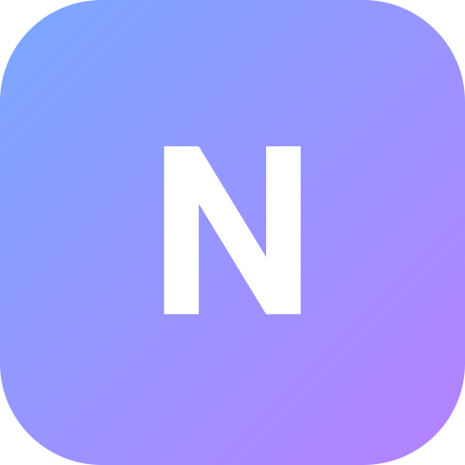

<p align="center"></p>

<h1 align="center">NovaOS · Orbit</h1>

<p align="center">A little space for big ideas. A desktop environment that lives in your browser.</p>

<p align="center"><strong>23 built-in apps · 3 workspaces · Local-first · Vanilla JavaScript</strong></p>

NovaOS brings a macOS-inspired glass desktop, movable windows, a virtual filesystem, and everyday tools together in one static web app. Spin the interactive globe, plan your week, capture an idea, or settle into a focus session—without an account or backend.

This is a browser-based desktop simulation, not a native operating system. It is an independent project, not affiliated with Apple.

## Quick start

Requires **Node.js 20 or later**. There are no npm dependencies to install and no build step.

```sh
git clone https://github.com/tanujranjith/web-based-os.git
cd web-based-os
npm start
```

Open [localhost:4187](http://127.0.0.1:4187). The development server binds to `127.0.0.1`, so it is available only on your machine by default.

Any static HTTP server can serve the project. Opening `index.html` directly with `file://` is unsupported because the app uses ES modules.

## Take a quick tour

1. **Make it yours.** Select **Customize desktop** at the bottom left to open Desktop Studio.
2. **Move the universe.** Drag the globe sideways to spin or vertically to tilt. Double-click to reset.
3. **Find your tools.** Open the Dock launcher for all apps, or press **Ctrl / Cmd + K** to search apps, files, notes, tasks, events, and commands.
4. **Make room.** Switch between Personal, Studio, and Focus using the menu bar. Window overview lets you move apps between spaces.
5. **Plan something good.** Click the date in the Today widget to open Calendar, or launch Project Board to organize your next project.

## A desktop you can shape

### Glass, motion, and atmosphere

- Translucent windows, traffic-light controls, working application menus, colorful icons, and a magnifying Dock.
- **Desktop Studio:** eight wallpapers, four globe materials, globe scaling, automatic orbit, orbital-ring visibility, and widget toggles.
- **Interactive globe:** two-axis drag rotation with release momentum. Arrow keys rotate, Shift increases the step, and Home resets. Reduced motion disables automatic rotation and momentum.
- **Control Center:** persistent glass tint, light/dark appearance, sound controls, reduced motion, and quick access to the focus timer.
- Calendar, focus, and scratchpad widgets, plus a recent-app shelf. Hide what you do not need.

### Space for your work

- Three workspaces: **Personal**, **Studio**, and **Focus**.
- Drag, resize, minimize, and maximize app windows. Use the title-bar layout button for halves, quarters, full-screen fill, or restoring a floating window.
- Window overview supports app switching, moving apps between spaces, and tiling the current workspace.
- Categorized launcher and global search, with keyboard navigation in application menus.
- **Do Not Disturb** keeps incoming notifications in Notification Center without banners or sounds.

### Tools that remember

- **Calendar:** month navigation, timed and all-day events, Personal/Work/Important categories, details, editing, and confirmed deletion. Events appear in search and the Today widget.
- **Project Board:** cards with descriptions and priorities, search, drag-and-drop columns, and keyboard-accessible status controls.
- **Pomodoro:** persistent focus sessions, pause/resume, skip, reset, short and long breaks, and deadline recovery after refresh. The timer continues when its app window closes.
- Notes, tasks, files, and preferences are stored locally for the active profile. Notes flush pending edits when their window closes.

## App catalog

| Collection | Apps |
| --- | --- |
| Productivity | Notes, Tasks, Calendar, Project Board, Pomodoro |
| Workspace & system | Files, Browser, Terminal, Settings, Desktop Studio, About |
| Utilities & development | Calculator, Clock, Code Editor, Markdown |
| Creative & media | Image Viewer, Paint, PDF Viewer, Camera, Music |
| Games | Snake, 2048, Minesweeper |

## Keyboard shortcuts

| Shortcut | Action |
| --- | --- |
| Ctrl / Cmd + Space | Open the launcher |
| Ctrl / Cmd + K | Search content, apps, and commands |
| Ctrl / Cmd + Shift + O | Open window overview |
| Ctrl / Cmd + Shift + 1 / 2 / 3 | Switch workspace |
| Ctrl / Cmd + Shift + D | Show the desktop |
| Ctrl / Cmd + M | Minimize the focused window |
| Ctrl / Cmd + , | Open Settings |
| Escape | Dismiss overlays |
| Arrow keys / Shift + Arrow keys | Rotate the focused globe / use a larger step |
| Home | Reset the focused globe |

Browser and operating-system shortcuts can take precedence. Visible controls are available for launcher, search, workspace, and window actions.

## Your data, on your device

NovaOS stores app content and preferences in browser storage for the **active profile and origin**. There is no server-side sync. Using another browser, hostname, protocol, or port creates a separate storage area.

- **Back up:** open **Settings → System → Export** to download your current profile's data.
- **Restore:** use **Settings → System → Import**. Import replaces the current profile's data after confirmation; export first if you want to keep it.
- Clearing site data removes local content. Private browsing, storage limits, and browser cleanup policies can also affect persistence.
- Workspace membership is session-only. App geometry, content, and supported preferences persist.
- Browser-local profiles are a convenience, not an operating-system security boundary. Do not treat local browser storage as an encrypted vault.

Calendar is a local planner, not a cloud calendar or background reminder service. Focus completion notifications appear while NovaOS is running, or when it is reopened after a deadline.

### Offline and browser limitations

The service worker uses network-first loading with a cache fallback. Successfully loaded resources can be reused offline; an uncached app or external resource may still need a connection.

External websites may block embedding in the Browser app. Camera access requires browser permission and a supported secure context, such as HTTPS or localhost. Media support depends on the browser. Extensions that alter page colors can override NovaOS's appearance; the app provides its own light/dark controls.

## Development

Built with **HTML, CSS, and native JavaScript modules**. No frontend framework, bundler, database, or application server is required.

```text
index.html              Desktop shell and stylesheet entry points
src/main.js             App registration and startup
src/core/               State, profiles, filesystem, window manager, timers
src/ui/                 Dock, launcher, search, globe, menus, desktop widgets
src/apps/               Built-in applications
styles/                 Shared, app, and desktop styling
scripts/serve.mjs       Local static development server
scripts/check.mjs       Syntax and local-import validation
tests/                  Node.js regression tests
sw.js                   Network-first offline caching
```

### Run checks

```sh
npm run check
npm test
```

The module check validates JavaScript syntax and relative imports. The **16 automated tests** cover calendar date/event validation and ordering, focus timer transitions and refresh recovery, and profile-safe backup restoration, including Calendar data and desktop preferences.

Manual browser checks have covered globe dragging and customization, saved events, window snapping, app launching, project persistence, workspace movement, appearance controls, and desktop/mobile layouts. Browser checks are not part of `npm test`.

### Add an app

1. Create a module in `src/apps/` exporting an app definition with `id`, `name`, and `mount(container, ctx)`. Existing apps show the optional category, keywords, default size, and lifecycle hooks.
2. Register it in `src/main.js` and add its SVG icon to `src/ui/icons.js`.
3. Keep profile data in the shared store, and release listeners or timers in the returned `unmount()` hook.
4. Add tests where appropriate, run both checks, and verify the app in floating, snapped, and mobile-sized windows.

For static hosting, serve the project root over HTTPS with its relative paths intact. There is no build output directory and no backend to deploy.
